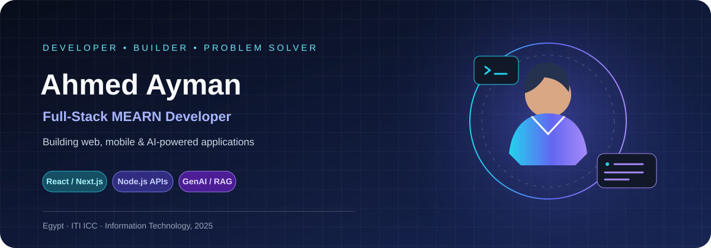

<picture>
  <source media="(prefers-color-scheme: dark)" srcset="portrait_dark.svg">
  <source media="(prefers-color-scheme: light)" srcset="portrait_light.svg">
  
</picture>

 

 

---

## 👋 About Me

I'm **Ahmed Ayman Abdelkareem**, a Full-Stack MEARN Developer based in Egypt. I enjoy building practical digital products—from responsive web interfaces and backend APIs to mobile applications and AI-powered features.

My main focus is the JavaScript/TypeScript ecosystem. I care about readable code, maintainable architecture, useful user experiences, and choosing a solution that fits the problem instead of adding unnecessary complexity.

- 🎓 **B.Sc. in Information Technology** — EELU, graduated in 2025
- 🚀 **ITI ICC trainee/alumnus** — Full-Stack Web & Generative AI Development (MEARN track)
- 🌐 Building with React, Next.js, Node.js, Express, and MongoDB
- 📱 Exploring cross-platform mobile development with React Native and Expo
- 🤖 Working with LLM APIs, structured outputs, RAG concepts, and AI workflow automation
- 📍 Egypt · Open to suitable full-stack, frontend, and AI-focused opportunities
- 🧭 **Portfolio:** [ahmed-abd-el-kareem.vercel.app](https://ahmed-abd-el-kareem.vercel.app/)

## ⚙️ Engineering Focus

| Focus | What I build |
|:--|:--|
| **Full-Stack Web** | Responsive interfaces, dashboards, REST APIs, authentication, and database-backed features |
| **Frontend Engineering** | React and Next.js applications, reusable components, state management, and data fetching |
| **Backend Development** | Node.js services, Express APIs, data modeling, validation, and integrations |
| **Mobile Development** | React Native and Expo applications with navigation and API integration |
| **Generative AI** | LLM API integrations, structured responses, retrieval-augmented generation concepts, and AI-enabled features |
| **Workflow Automation** | n8n workflows connecting AI services, application data, and human approval steps |

## 🧰 Tech Stack

### Languages

  

### Frontend & UI

  
   
  
  
  

### Backend & Databases

  
   
  
  
  

### Mobile Development

  
  
  
  
  

### Generative AI & Automation

  
  
  
  
  
  
  
  

### Tools & Platforms

  

## 🧠 AI Engineering Interests

| Area | Experience / interests |
|:--|:--|
| LLM integration | Connecting applications to model APIs and handling structured responses |
| Information extraction | Turning document or text input into structured data with validation |
| RAG | Exploring retrieval-based context for more grounded AI responses |
| AI workflow automation | Orchestrating model calls and approval steps with n8n |
| Product integration | Bringing AI capabilities into full-stack applications instead of building isolated demos |

*I focus on practical application-level AI and continuously build on these skills.*

---

## 🚀 Featured Projects

<b>🌍 Rahal — Smart AI Travel Planner for Egypt</b>

 

A graduation project for planning personalized trips in Egypt based on a traveler's budget, destination, duration, group size, and interests. The project spans web, backend, dashboard, and mobile experiences.

**Highlights**
- Personalized travel-planning experience
- Full-stack architecture with a dedicated backend and admin dashboard
- English/Arabic interface support in the web experience
- Separate React Native mobile application
- AI-assisted trip-planning features

**Tech:** Next.js, TypeScript, Tailwind CSS, Zustand, TanStack/React Query, Node.js, Express, MongoDB, Redis/BullMQ, React Native, Expo, and LLM integrations.

| Resource | Link |
|:--|:--|
| Main website | [rahal-main-site.vercel.app](https://rahal-main-site.vercel.app/) |
| Backend repository | [Rahal-Back-End](https://github.com/Ahmed-Abd-EL-Kareem/Rahal-Back-End) |
| Dashboard repository | [Rahal-Dashboard](https://github.com/Ahmed-Abd-EL-Kareem/Rahal-Dashboard) |
| Mobile repository | [rahal-mobile](https://github.com/Ahmed-Abd-EL-Kareem/rahal-mobile) |

<b>🤖 Impact Circles — AI Agents & Automation Demos</b>

 

A demonstration project exploring two n8n-integrated AI workflows for an entrepreneurship assignment.

**Workflows**
- **Financial Document Assistant:** extract invoice/receipt information, categorize expenses, validate results, and flag possible duplicates for review.
- **Content Generation Agent:** create content drafts for channels such as LinkedIn, newsletters, and website announcements, with a human approval step before mock publishing.

**Tech:** n8n, Gemini API, PostgreSQL/Neon, and a mock publishing API.

[View repository →](https://github.com/Ahmed-Abd-EL-Kareem/impact-circles-ai-automation)

<b>💻 Explore more of my work</b>

 

I also work on frontend interfaces, backend APIs, dashboards, and smaller full-stack experiments.

- [All GitHub repositories](https://github.com/Ahmed-Abd-EL-Kareem?tab=repositories)
- [Portfolio projects](https://ahmed-abd-el-kareem.vercel.app/)

---

## 📊 GitHub Statistics

  
  

  

## 🐍 Contribution Snake

  <picture>
    <source media="(prefers-color-scheme: dark)" srcset="https://raw.githubusercontent.com/Ahmed-Abd-EL-Kareem/Ahmed-Abd-EL-Kareem/output/snake-dark.svg">
    <source media="(prefers-color-scheme: light)" srcset="https://raw.githubusercontent.com/Ahmed-Abd-EL-Kareem/Ahmed-Abd-EL-Kareem/output/snake-light.svg">
    
  </picture>

## 📈 Contribution Activity

  

---

## 🎓 Education & Professional Development

- **Information Technology** — Egyptian E-Learning University (EELU), graduated 2025
- **ITI ICC** — Full-Stack Web & Generative AI Development, MEARN track
- Ongoing practice in full-stack development, React Native, LLM integrations, and workflow automation

## 🏅 Highlights

- Built **Rahal**, a multi-part graduation project covering web, backend, dashboard, mobile, and AI-assisted travel planning.
- Developed a **React Native / Expo mobile application** as part of the Rahal project.
- Building practical AI automation demos with **n8n and Gemini**, including structured extraction and human-in-the-loop content review.
- Interested in maintainable full-stack solutions and pragmatic architecture.

---

## 🤝 Let's Connect

I'm happy to connect about full-stack development, React and Next.js, mobile applications, and practical AI integrations.

  
  
  

   
  <i>Build useful things. Keep learning. Make technology work for people.</i>
    
  

